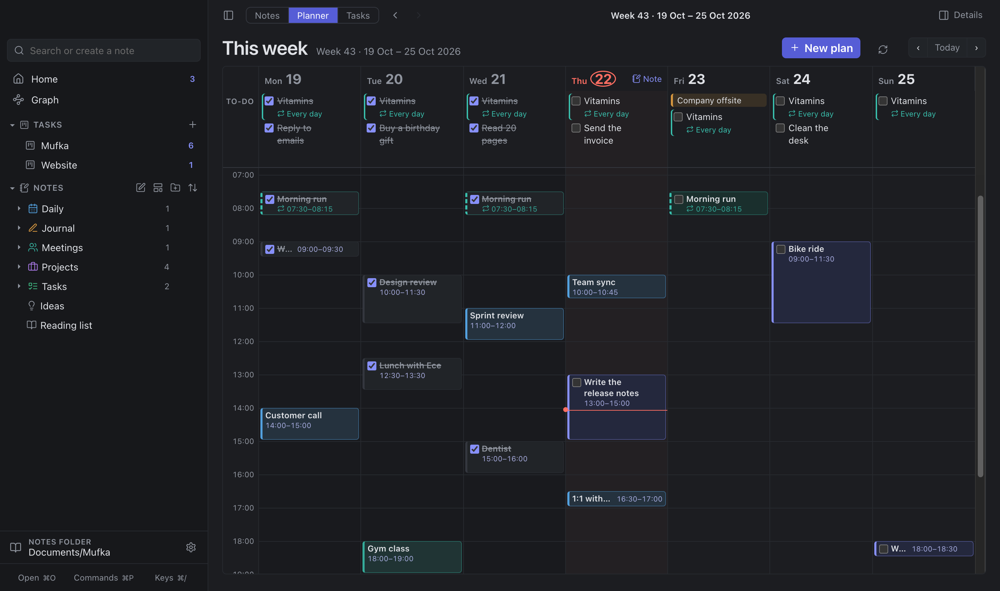
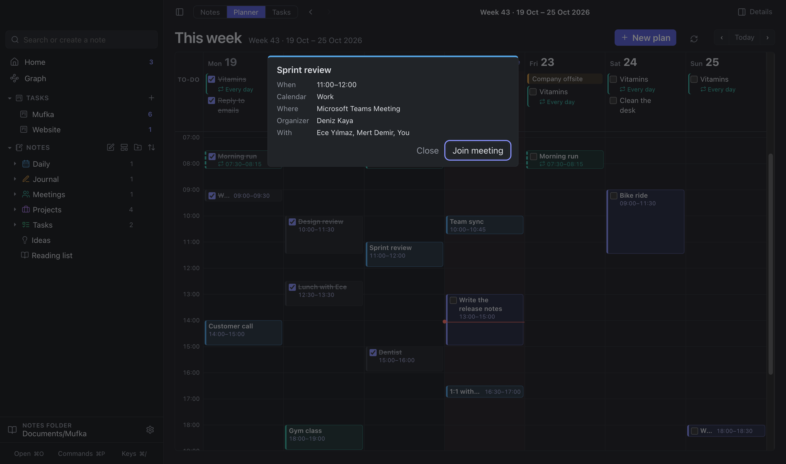
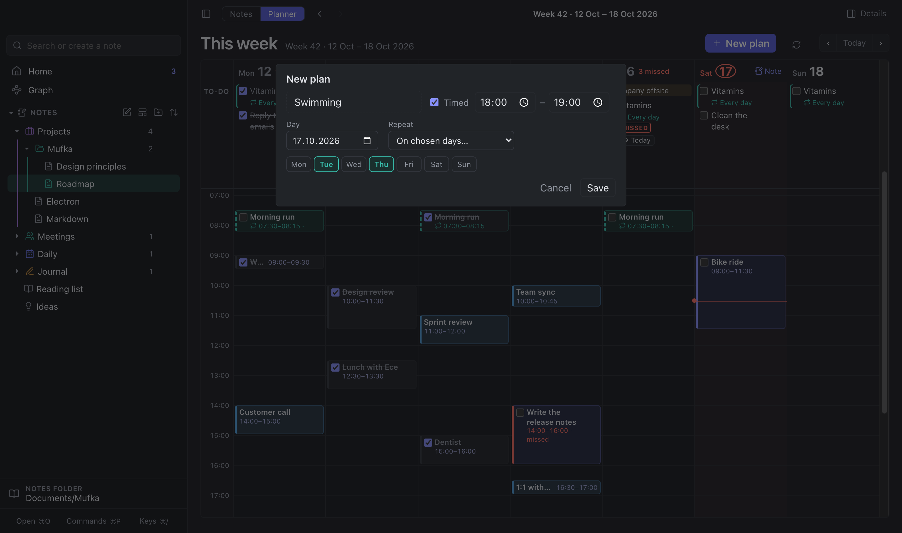
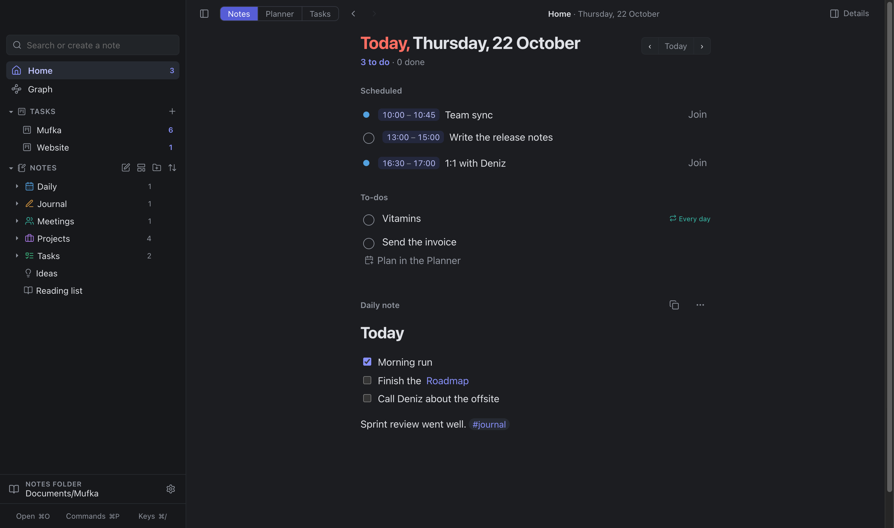
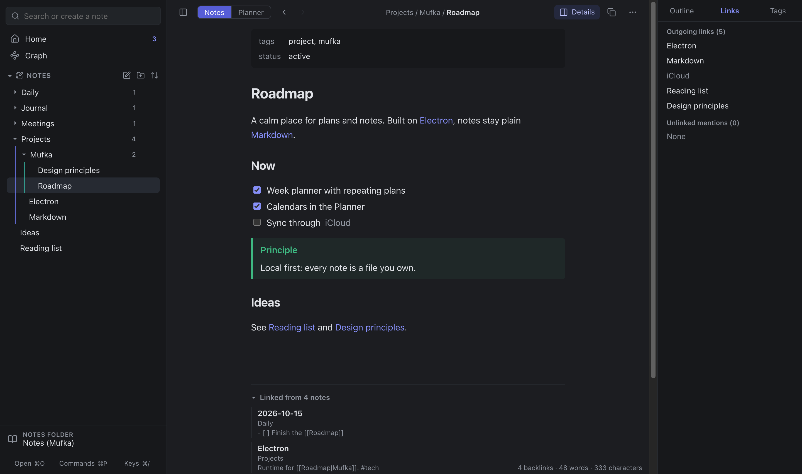
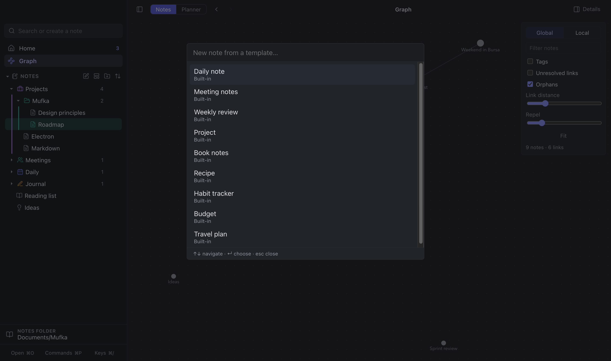
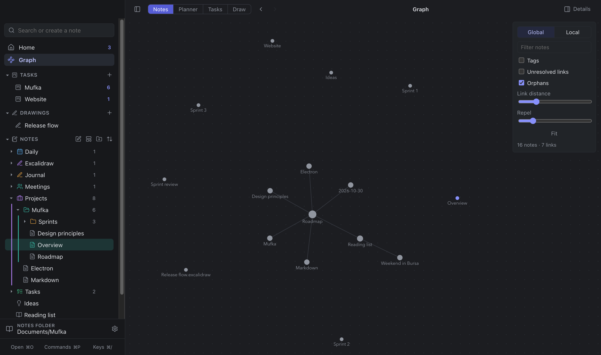
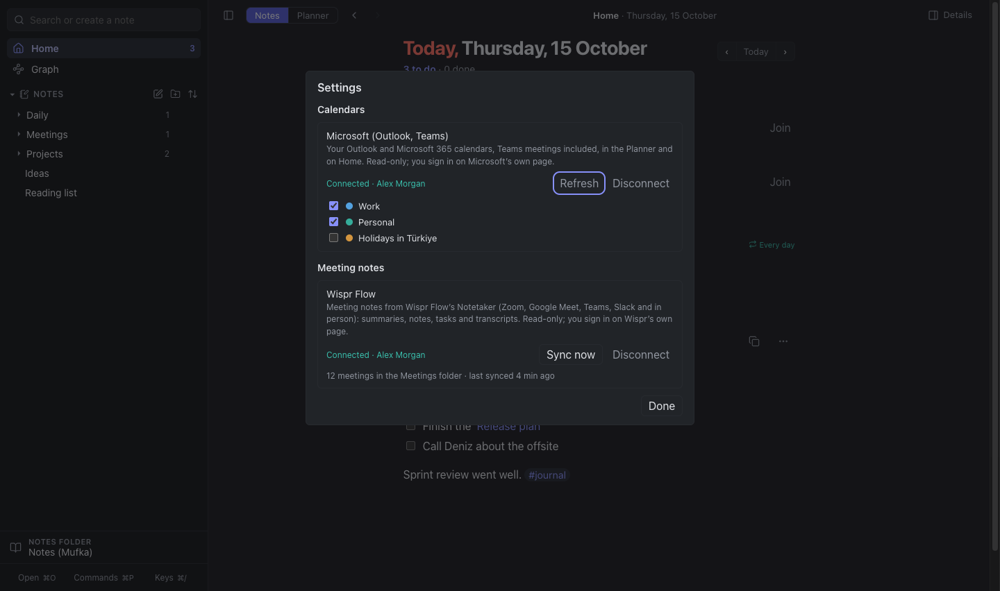

<div align="center">


# Mufka

**Your week and your notes, in one calm app for Mac and Windows.**

A week planner with times, repeating plans and your Outlook, Teams and Google
calendars, and an Obsidian‑like Markdown notes vault with links, backlinks and
a graph — local and private.

**[mufka.app](https://mufka.app)** · [Download](https://github.com/batuhan-bas/mufka/releases/latest) · [Privacy](https://mufka.app/privacy) · [Support](https://mufka.app/support)



</div>

---

## Contents

- [What Mufka does](#what-mufka-does)
- [Install it on a Mac](#install-it-on-a-mac)
- [Install it on Windows](#install-it-on-windows)
- [Your notes and your data](#your-notes-and-your-data)
- [Keyboard shortcuts](#keyboard-shortcuts)
- [For the developer](#for-the-developer)
- [License](#license)

## What Mufka does

Mufka has two modes, switched at the top left (**Notes | Planner**, or ⌃Tab).

### Planner — the week at a glance

- **Monday to Sunday** in columns: to-dos on top, an **hour grid** below, a red
  line for "now".
- **New plan** asks for everything at once: title, day, start and end time,
  and **Repeat** — every day, weekdays, every week, chosen days, or monthly.
- **Repeating plans** look different (teal, dashed edge, ↻ and their rule), so
  "this happens every Tuesday" is visible at a glance.
- **Missed** plans — not done after their time — get a coral edge and a
  one-click **→ Today**. Nothing moves on its own.
- **Your calendars in the week:** connect **Microsoft (Outlook, Teams)** and
  **Google Calendar** in **Settings** (⌘,) and your meetings appear next to
  your plans, in each calendar's colour; all-day events sit on top. Click one
  for when, where and who, and **Join meeting** for Teams, Meet or Zoom links.
  Read-only: Mufka never changes your calendars. Choose which calendars to
  show; ↻ refreshes.
- Move plans by **dragging** (to another day or time; drag the bottom edge to
  change the end), with the ⋯ menu, or with the keyboard (⌥←/→ a day, ⌥↑/↓ 15
  minutes). Every change can be undone with ⌘Z.

<p align="center"></p>

<p align="center"></p>

### Home — today

Today's date, what you planned for it and today's meetings in time order
(tick plans off here, **Join** a meeting), and the day's note. Nothing planned
yet? Home offers to open the Planner.

<p align="center"></p>

### Notes — an Obsidian-like vault

- **Plain Markdown files** in folders — by default in **`~/Documents/Mufka`**,
  where Finder and iCloud see them, or open any folder, such as an existing
  **Obsidian vault** (nothing is copied).
- **Your sidebar, your way:** every folder and note has an icon; give one a
  **colour** or another **icon** (or any emoji) from its ⋯ menu. A folder's
  colour is its guide line's, and the selected row takes it. **Drag** items
  to put them in your own order, or into another folder. Icons, colours and
  order are kept in the vault's `.mufka/tree.json`, so they travel with your
  notes.
- **Write in place**: notes always look formatted; click a paragraph to edit it.
  Tables, task lists, callouts, footnotes, frontmatter, `==highlights==`.
- **`[[Links]]`** with autocomplete, **backlinks** under every note, **page
  preview** on hover, `![[embeds]]` of other notes and images.
- **Details** panel: outline, outgoing links, unlinked mentions (one click turns
  a mention into a link) and all tags.
- **Templates:** start a note from one of nine — daily note, meeting notes,
  weekly review, project, book notes, recipe, habit tracker, budget and travel
  plan — or from your own `Templates` folder (Obsidian-compatible). Copy the
  built-in ones there to make them yours.
- **Bookmarks**, drag-and-drop **images** and files, export to **PDF** or
  Markdown, sorting by name, last edit or your own order.
- **Meeting notes from [Wispr Flow](https://wisprflow.ai)**: connect your
  Wispr account in **Settings** (⌘,) and every meeting its Notetaker records —
  Zoom, Google Meet, Teams, Slack huddles or in person — arrives in a
  **Meetings** folder as a note: summary, tasks, your notes and the transcript.
  Read-only; it checks every 15 minutes. Wispr Flow's dictation also types
  straight into any note.

<p align="center"></p>

<p align="center"></p>

### Graph, search and commands

- **Graph** shows how notes connect; hover to highlight, click to open, or show
  just one note's neighbourhood.
- **Search** at the top of the sidebar finds notes and plans (and creates a note
  when nothing matches). **⌘O** jumps to any note, **⌘P** runs any command,
  **⌘/** lists every shortcut.

<p align="center"></p>

## Install it on a Mac

**Needs:** macOS 12 Monterey or later, Apple silicon or Intel.

1. Download **`Mufka-<version>-universal.dmg`** from the
   [Releases](https://github.com/batuhan-bas/mufka/releases) page (or build it
   yourself, see [For the developer](#for-the-developer)).
2. Open it and drag **Mufka** onto **Applications**.
3. Open **Mufka** from Applications. The first time, macOS asks whether to
   open an app downloaded from the internet — click **Open**. Mufka is signed
   by Calexis Labs and notarized by Apple.
4. When Mufka asks to send notifications, click **Allow** — that is how plan
   reminders reach you. (If you skip it, reminders appear inside the window.)

That's it: Mufka opens on **Home**. Updates are installed the same way —
replace the app in Applications; your notes and plans stay.

> **Updating from 1.5.1 or older?** Those were not notarized. After the first
> signed update macOS may ask once more for notifications and for Mufka's
> keychain item ("Mufka Safe Storage"): allow both (**Always Allow** for the
> keychain) so your calendar and Wispr sign-ins keep working.

### Uninstall

Drag Mufka from Applications to the Trash. Your notes stay in
`~/Documents/Mufka` (or the notes folder you chose) and your plans in
`~/Library/Application Support/Mufka` until you delete them.

## Install it on Windows

**Needs:** Windows 10 or 11, 64-bit.

1. Download **`Mufka-<version>-Setup.exe`** from the
   [Releases](https://github.com/batuhan-bas/mufka/releases) page.
2. Edge may say the file *"isn't commonly downloaded"*: open the download's
   **⋯** menu → **Keep**. Mufka is not signed with a paid Microsoft certificate
   yet, so when you run it Windows SmartScreen says *"Windows protected your
   PC"*: click **More info** → **Run anyway**. Then install "only for me" and
   finish.
3. Open **Mufka** from the Start menu or the desktop shortcut.

Everything works as on a Mac, with **Ctrl** where the Mac uses **⌘** (Ctrl+O,
Ctrl+P, Ctrl+Shift+P…); the app shows shortcuts the Windows way. Notes are in
`Documents\Mufka`, plans in `%APPDATA%\Mufka`. Updates: run the new installer;
your notes and plans stay. **Uninstall** from **Settings → Apps**.

## Your notes and your data

Everything stays on your computer; there is no account and no server. The exceptions
are the connections you turn on yourself in **Settings**: your **Microsoft**
and **Google** calendars (Mufka reads your events; it asks only for calendar
read access) and **Wispr Flow** (Mufka reads your meetings). Mufka never sends
your notes or plans anywhere. Sign-ins are kept encrypted (in the macOS Keychain, or by Windows for your user account);
**Disconnect** forgets them. Details: the [privacy policy](https://mufka.app/privacy).

<p align="center"></p>

| What | Where |
|---|---|
| Notes | `~/Documents/Mufka` — or any folder you open with **Notes folder** at the bottom of the sidebar (for example your Obsidian vault). Plain `.md` files. |
| Plans | `~/Library/Application Support/Mufka/planlar.json` (Windows: `%APPDATA%\Mufka\planlar.json`) |
| Backups | **File → Export Plans…** writes a JSON copy; notes are ordinary files, so any backup tool (Time Machine, iCloud Drive, git) works. |

Notes kept by Mufka before 1.4 (in `~/Library/Application Support/Mufka/Notes`) move to `~/Documents/Mufka` by themselves the first time 1.4 starts; a folder you chose yourself stays where it is.

## Keyboard shortcuts

On Windows, Ctrl takes the place of ⌘ and Alt of ⌥.

| Shortcut | Does |
|---|---|
| ⌘T | Home (today) |
| ⌘1 · ⌃Tab | Planner · switch Notes / Planner |
| ⇧⌘P | New plan |
| ⌥⌘← / ⌥⌘→ | Previous / next week |
| ⌘N | New note |
| ⌘O · ⌘P | Open a note · command palette |
| ⌘F | Search |
| ⌘G · ⇧⌘G | Graph · local graph |
| ⌘E | Edit a note's raw Markdown |
| ⌘, | Settings (calendar and Wispr Flow connections) |
| ⇧⌘T | Insert a template |
| ⌘[ · ⌘] | Back · forward |
| ⌘\\ · ⇧⌘\\ | Sidebar · Details panel |
| ⌘Z · ⇧⌘Z | Undo · redo |
| ⌘/ | All shortcuts |

---

## For the developer

Electron + plain JavaScript (no UI framework), built with
[electron-vite](https://electron-vite.org). All pure logic lives in `lib/*.mjs`
and is shared verbatim by the app and the tests.

```sh
npm install              # dependencies, then downloads Electron (pnpm works too)
npm run dev              # develop with hot reload
npm start                # build, then run the built app
npm test                 # unit tests, then build + the real end-to-end test
npm run dist             # build the signed universal .dmg into dist/
npm run dist:public      # the same, ad-hoc signed: for sharing / Releases
npm run dist:win         # the Windows installer (.exe), on Windows or a Mac
npm run sign:dev         # sign the dev Electron so notifications work in npm start
```

Every push and pull request runs the unit tests and the end-to-end test on
macOS and on Windows (GitHub Actions); the Windows run also uploads
screenshots and an installer.

### Building the app

```sh
npm run dist
```

This writes **`dist/Mufka-1.0.0-universal.dmg`** (one app for Apple silicon and
Intel). The app is signed with the first Developer ID or Apple Development
identity in your keychain (`MUFKA_SIGN_IDENTITY` overrides it; without one it
is ad-hoc signed), which is what lets macOS show notifications. It is not
notarized, so whoever opens it needs **System Settings → Privacy & Security →
Open Anyway** once.

**`npm run dist:public`** is the same, signed ad-hoc: no certificate (and the
name and email in it) ends up inside the app.

**`npm run dist:release`** builds the copy on Releases: signed with Calexis
Labs' Developer ID, hardened runtime, and notarized by Apple
(`electron-builder.release.cjs`). It needs that identity in the keychain and an
App Store Connect API key in `APPLE_API_KEY` (path to the `.p8`),
`APPLE_API_KEY_ID` and `APPLE_API_ISSUER`.

**Google Calendar** needs an OAuth client of type *Desktop app* (Google Cloud
Console → Google Auth Platform → Clients). Its id and secret are not in this
repository; put them in a git-ignored `.env.local` before building:

```sh
MAIN_VITE_GOOGLE_CLIENT_ID=….apps.googleusercontent.com
MAIN_VITE_GOOGLE_CLIENT_SECRET=…
```

Without it, Settings shows Google as "not set up"; everything else works.
Microsoft uses Mufka's public app registration (`lib/calendar.mjs`).

Bump `version` in `package.json` before building a new copy, so people can
tell versions apart.

### Tests

UI behaviour is proven by a real end-to-end test (`test/e2e.js`): it boots the
built app with a throwaway data folder, drives it only through real input
events (clicks, keys, drags, OS file drops) and checks the files on disk. Pure
logic has `node:test` suites next to each `lib/` module.

### Project notes

The name **Mufka** and the app id are fixed: changing `productName` would
move the data folder.

## Contributing

Issues and pull requests are welcome. Run `npm test` (unit tests and the
end-to-end test) before opening a pull request.

## License

[MIT](LICENSE) © 2026 Calexis Labs.

Mufka includes open-source components under their own licenses (Electron,
mdast/micromark, Lucide icons); see
[`THIRD_PARTY_NOTICES.md`](THIRD_PARTY_NOTICES.md).
